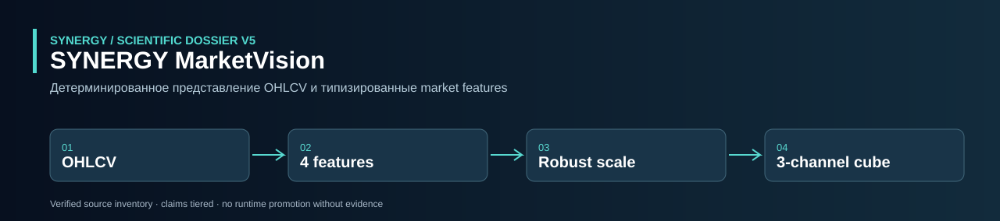
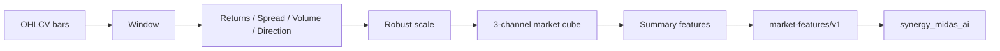

<!-- SCIENTIFIC-V5-2026:START -->


**[Научно-техническое досье V5: математика, исходники, тесты, ограничения](docs/SCIENTIFIC_DOSSIER_V5_2026.md)**  
**Проверяемый статус:** CANDIDATE: исходники и unit-tests; не торговый прогноз. Предыдущий README ниже сохранён; наличие кода не означает подтверждённого production.

<!-- SCIENTIFIC-V5-2026:END -->

#  SYNERGY MarketVision — verified technical dossier

> **Статус:**  CANDIDATE — deterministic market-feature cube, typed contract, enterprise API and tests exist.
> **Проверено по фактическому source/tests:** 29.09.2026.

## 1.  Задача

`synergy_marketvision` превращает OHLCV bars в нормализованное многоканальное market representation для downstream analytics.

Ключевой принцип:

```text
feature cube != forecast
feature summary != trading signal
market perception != execution authority
```

## 2.  Фактический состав

Repository содержит Python package:

- `core.py`;
- `api.py`;
- `synergy_contracts.py`;
- enterprise layer;
- tests;
- Docker/deploy/loadtest scaffolding.

## 3.  Required input schema

`core.py` требует columns:

```text
open
high
low
close
volume
```

Если хотя бы одной колонки нет — `ValueError`.

Для `window` требуется минимум столько строк.

## 4.  Feature construction

Для последних `window` bars вычисляются четыре raw features.

### Log return

[
r_t=
log(close_t)-log(close_{t-1})
]

с защитой от near-zero через `maximum(close,1e-12)`.

### Relative high-low spread

[
spread_t=
rac{high_t-low_t}{|close_t|}
]

### Log volume

[
v_t=log(1+max(volume_t,0))
]

### Direction

[
d_t=sign(r_t)
]

Затем data matrix robust-scaled по median/IQR.

Если IQR=0, denominator заменяется на 1.

## 5.  Market cube

После scaling формируются три channels:

1. signed scaled features;
2. absolute scaled features;
3. sign of scaled features.

Итоговая shape:

```text
3 x window x 4
```

dtype = `float32`.

Это market representation, а не image classifier и не prediction model.

## 6.  Summary features

`summary_features()` возвращает:

- shape;
- mean;
- std;
- energy:
  [
  E=mean(cube^2)
  ]

## 7.  Архитектура



## 8.  Federation contract

```text
CONTRACT_ID = synergy.trading.market-features/v1
AUTHORITY   = market_perception
```

`market_features_payload` требует:

- symbol;
- bars;
- window;
- observation id.

Output:

- observation id;
- normalized symbol;
- window;
- summary features;
- `authorization=false`.

## 9.  Inputs /  Outputs

Inputs: OHLCV bars + observation metadata.

Output contract не передаёт полный cube — только summary dict.

Это важно: downstream `market-features/v1` в текущей реализации получает aggregate representation, не raw tensor.

## 10.  Invariants

```text
missing OHLCV -> reject
insufficient rows -> reject
negative volume -> clipped before log1p
feature cube != signal
summary feature != alpha
authorization = false
```

## 11.  Реальные tests

Enterprise product test:

- строит 20 synthetic OHLCV bars;
- запрашивает window=16;
- вызывает `POST /enterprise/v1/marketvision/features`;
- проверяет `shape`, `energy`, `request_id`;
- audit linkage;
- viewer role → 403;
- health/features routes существуют.

Дополнительно есть tests core, service, adapters, deployment, release metadata и federation contract.

## 12.  Scientific limitations

Текущий feature cube:

- не содержит order book;
- не содержит bid/ask;
- не содержит cross-asset context;
- robust scaling производится внутри текущего window;
- не является learned representation;
- summary сильно сжимает tensor до mean/std/energy.

Следовательно доказательство полезности для trading требует отдельного downstream ablation/OOS benchmark.

## 13.  Required benchmarks

- cube vs raw OHLCV baseline;
- robust-scale vs standardization;
- channel ablation;
- window sensitivity;
- asset/timeframe transfer;
- leakage audit;
- frozen preprocessing parity;
- downstream model OOS;
- shuffled-label sanity;
- latency/memory benchmark.

## 14.  Data provenance gaps

Contract имеет `observation_id`, но для сильной provenance модели нужны:

- source;
- symbol venue;
- timeframe;
- bar timestamps;
- last-bar close time;
- data hash;
- preprocessing version.

Без этого одинаковый observation id нельзя независимо воспроизвести.

## 15.  Воспроизводимость

```bash
git clone https://github.com/Shtenco/synergy_marketvision.git
cd synergy_marketvision
python -m pip install -e .
pytest -q
```

## 16.  Карта repository

| Path | Role |
|---|---|
| `src/.../core.py` | feature cube |
| `src/.../synergy_contracts.py` | market-features/v1 |
| `src/.../api.py` | API |
| `src/.../enterprise/` | auth/audit |
| `tests/` | product/service/deploy tests |
| `Dockerfile` | container |
| `deploy/` | deployment |
| `loadtests/` | load testing |

## 17.  Место в SYNERGY

```text
market bars
→ synergy_marketvision
→ market-features/v1
→ synergy_midas_ai
```

MarketVision имеет perception authority только в рамках формата features; не имеет trade authority.

## 18.  Evidence maturity

| Layer | Status |
|---|---|
| deterministic features |  |
| robust scaling |  |
| market cube |  |
| summary contract |  |
| enterprise tests |  source |
| provenance-complete bars | incomplete |
| alpha/OOS proof |  |
| observed federation E2E |  |

## 19.  Roadmap

1. add timestamps/source/hash;
2. version preprocessing;
3. persist cube evidence;
4. benchmark against raw baseline;
5. downstream ablations;
6. cross-asset OOS;
7. M4 observed federation evidence.

## 20.  Что проект НЕ утверждает

- что cube сам предсказывает цену;
- что energy имеет trading edge;
- что feature output разрешает сделку;
- что source tests уже production-green;
- что current preprocessing optimal.

## 21.  Feature invariance and leakage tests

Because MarketVision is preprocessing infrastructure, correctness is largely about transformations.

### Causal window

For an observation ending at time (t), every value in the cube must come from bars with timestamp (le t). A regression test should mutate future bars and assert that the current cube hash does not change.

### Scale parity

Training and live inference must use the same preprocessing semantics. Current robust scaling is fitted inside each window; that gives local normalization, which may be intentional, but it must be versioned because it differs from a frozen global scaler.

### Zero-IQR feature

When IQR=0 the code substitutes denominator 1. Tests should verify that constant columns remain finite and interpretable.

### Volume edge cases

Negative input volume is clipped before `log1p`. Tests should record that policy explicitly rather than silently accepting bad market data.

## 22.  Proposed full observation evidence

The current federation payload emits summary features only. For reproducibility, an evidence artifact should additionally preserve:

```text
observation_id
symbol
venue/broker
timeframe
first_bar_time
last_bar_time
bar_count
raw_bars_sha256
window
preprocessing_version
cube_sha256
summary
software_commit
```

The full cube can be stored externally/content-addressed if payload size is a concern.

## 23.  Benchmark matrix

MarketVision should be evaluated as a feature representation, not by standalone aesthetics.

Compare downstream on identical OOS folds:

| Representation | Required comparison |
|---|---|
| raw returns/volume | baseline |
| handcrafted standard TA | baseline |
| current 3-channel cube | candidate |
| cube without abs channel | ablation |
| cube without sign channel | ablation |
| alternative window sizes | sensitivity |

Metrics should include downstream score **and** preprocessing latency/RAM.

## 24.  Promotion gate

Promotion requires:

- causal-window proof;
- timestamp/source provenance;
- deterministic cube hashes;
- preprocessing version;
- cross-process parity;
- baseline/ablation OOS evidence;
- consumer contract observed in MIDAS.

Until those exist, MarketVision is a deterministic feature producer, not a proven alpha source.

---

[ SYNERGY SYSTEM](https://github.com/Shtenco/synergy_system) · [ Atlas](https://github.com/Shtenco/synergy_system/blob/main/docs/SYNERGY_REPOSITORY_ATLAS.md)
