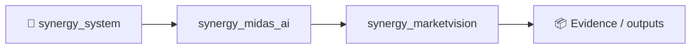
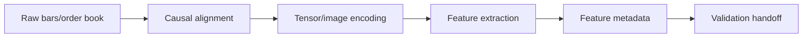

# SYNERGY MarketVision

> **3D/CV-ready market-state tensors and alternative feature generation for quant research**

Version: `2.0.0`

**Enterprise v2.0.0** · FastAPI/OpenAPI · Docker/Compose · RBAC/JWT · PostgreSQL/ClickHouse audit

**Designed for:** Quant research teams, systematic funds, prop firms and alternative-data teams  
**Primary endpoint:** `POST /enterprise/v1/marketvision/features`

> [!IMPORTANT]
> Feature-generation infrastructure only. Alternative representations do not guarantee predictive power or trading profit.

## Verification
**19 tests passed** · health smoke **80/80 200** · local p95 **62.4 ms** (~630 req/s). Health smoke only.

## Quick start
```bash
pip install -e '.[dev,enterprise]'
pytest -q
python -m synergy_marketvision.api
```

## CTO package
[Due diligence](docs/CTO_DUE_DILIGENCE.md) · [Architecture](docs/ARCHITECTURE_DIAGRAMS.md) · [API](docs/API_EXAMPLES.md) · [Security](SECURITY.md) · [Benchmarks](docs/BENCHMARKS_AND_ACCEPTANCE.md) · [SLA/SLO](docs/SLA_SLO.md) · [Deployment](docs/DEPLOYMENT_CHECKLIST.md) · [Pilot](docs/CUSTOMER_PILOT.md)


<!-- SYNERGY-FEDERATION-PASSPORT:START -->
---

## 🧭 SYNERGY federation passport

**Домен:** 👁️ Market perception layer  
**Архитектурный родитель:** [`synergy_midas_ai`](https://github.com/Shtenco/synergy_midas_ai)  
**Архитектурный корень:** [`synergy_system`](https://github.com/Shtenco/synergy_system)



Архитектурная стрелка — это карта федерации, а не автоматически подтверждённая runtime dependency.

### Единый стандарт

Каждый проект должен документировать реальную проблему, реализацию, тесты, evidence, ограничения, file map, воспроизводимость, roadmap и границы утверждений. Это тот же принцип, который используется в `dlp_solver`.

### Навигация

- [📚 Атлас всех 75 репозиториев](https://github.com/Shtenco/synergy_system/blob/main/docs/SYNERGY_REPOSITORY_ATLAS.md)
- [🧾 Машиночитаемый registry](https://github.com/Shtenco/synergy_system/blob/main/registry/SYNERGY_REPOSITORIES.json)
- [🧭 SYNERGY SYSTEM](https://github.com/Shtenco/synergy_system)

### Evidence rule

`GREEN` означает только воспроизводимо подтверждённый тезис. Гипотеза, benchmark без корректного протокола, архитектурная диаграмма или красивый экономический цикл сами по себе GREEN не дают.

<!-- SYNERGY-FEDERATION-PASSPORT:END -->
---

# 👁️ Глубокая техническая спецификация MarketVision

## 🎯 Проблема

Красивое 3D/CV-представление рынка может кодировать leakage или не иметь дополнительной predictive value. MarketVision должен быть feature generator с проверяемой причинной привязкой.

## 🏗️ Pipeline



## 📥 Входы

- OHLCV/order book;
- timestamps;
- session/calendar;
- normalization parameters;
- optional alternative data;

## 📤 Выходы

- versioned tensors/features;
- feature provenance;
- lookback window;
- normalization metadata;
- quality flags;

## 🛡️ Непереговорные инварианты

```text
no future pixels/features
normalization fit only on allowed history
feature timestamp <= decision timestamp
representation quality != predictive quality
all transforms reproducible
```

## 🧪 Как ловить ложный GREEN

- health/API throughput не использовать как доказательство market edge;
- обязательны timestamp/state-version checks;
- adversarial/negative fixtures должны проверять отказ;
- сохранять полный request → decision → execution/evidence trace;
- live claims отделять от local smoke и simulation;
- cost/latency/failure assumptions должны быть явными.

## 🔗 Контракт с соседями

- [`computer_vision_trading_metatrader_5`](https://github.com/Shtenco/computer_vision_trading_metatrader_5)
- [`3D_bars_market_structure`](https://github.com/Shtenco/3D_bars_market_structure)
- [`synergy_quantlab`](https://github.com/Shtenco/synergy_quantlab)
- [`synergy_midas_ai`](https://github.com/Shtenco/synergy_midas_ai)

## 🚀 Следующий доказательный рубеж

1. frozen acceptance fixtures;
2. negative/adversarial suite;
3. typed cross-repo schema;
4. end-to-end trace ID;
5. rollback/recovery evidence;
6. documented failure-mode table;
7. reproducible evidence bundle.
