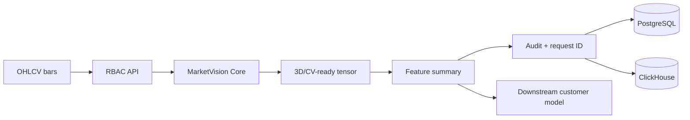

# Architecture — SYNERGY MarketVision

Primary endpoint: `/enterprise/v1/marketvision/features`. Generated representations/features do not imply predictive power; downstream OOS validation is required.