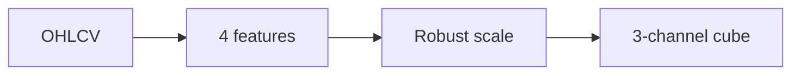

# SYNERGY MarketVision — научно-техническое досье V5

**Ревизия:** 24.10.2026 · **Партия:** репозитории SYNERGY №68–82 · **Фактический статус:** CANDIDATE: исходники и unit-tests; не торговый прогноз.

> Исходники и наличие тестов проверены по дереву `main`. Это **документационный аудит**, не свидетельство свежего CI, успешного деплоя, воспроизводимого benchmark или экономической прибыли. Старый README сохранён.

## 1. Научная постановка

Преобразовать последние W баров OHLCV в воспроизводимый трёхканальный тензор, не подменяя наблюдение рынка инвестиционным решением.

## 2. Реализация и исследовательская новизна

`market_cube` проверяет `open/high/low/close/volume`, вычисляет log-return, относительный range, log1p(volume) и sign(return), затем поколоночно нормализует median/IQR. Выход: `float32` формы `(3, window, 4)` — значения, модуль, знак.

## 3. Математическая формализация

\[r_t=\ln(\max(c_t,10^{-12}))-\ln(\max(c_{t-1},10^{-12})),\qquad s_t=\frac{h_t-l_t}{\max(|c_t|,10^{-12})}.\]
\[z_{t,j}=\frac{x_{t,j}-\operatorname{median}(x_{:,j})}{\operatorname{IQR}(x_{:,j})\ \text{or}\ 1},\quad C=\operatorname{stack}(z,|z|,\operatorname{sign}(z)).\]

Разграничение: формула, реализованная в исходном коде, может быть перепроверена статически; численные результаты и перенос на реальные данные требуют отдельного исполнения с артефактами и независимыми baseline.

## 4. Операционная цепочка



`architecture` описывает поток данных и проектное назначение; автоматически подтверждённой federated runtime-связи отсюда не следует.

## 5. Навигация по проверенным артефактам

- [`src/synergy_marketvision/core.py`](../src/synergy_marketvision/core.py)
- [`src/synergy_marketvision/api.py`](../src/synergy_marketvision/api.py)
- [`src/synergy_marketvision/synergy_contracts.py`](../src/synergy_marketvision/synergy_contracts.py)
- [`tests/test_core.py`](../tests/test_core.py)
- [`tests/test_synergy_contracts.py`](../tests/test_synergy_contracts.py)

## 6. Воспроизведение: доступная команда

```bash
python -m pip install -e .
python -m pytest -q
```

Команды приведены как **инструкция для самостоятельного запуска**, они не означают, что тесты были выполнены в рамках данной документационной ревизии.

## 7. Проверяемые гипотезы и acceptance gates

Проверить форму и dtype тензора; NaN/Inf, нулевой объём и nonpositive close; совместимость схемы `market-features/v1`; причинность окон при streaming и отсутствие look-ahead.

**Граница доказательности:** `SOURCE_PRESENT` и `TEST_SOURCE_PRESENT` отличаются от `TEST_EXECUTED`, `INTEGRATION_VERIFIED`, `DEPLOYED` и `PRODUCTION_READY`. Для повышения статуса нужны command, environment, commit SHA, input manifest, raw output и критерий проверки.

## 8. Угрозы и отказоустойчивость

Data leakage, неверные timestamp/баровые границы, NaN/Inf, различие схем downstream, недостоверное округление данных.

## 9. Не доказано / ограничения

Тензор не является CNN/LLM-моделью или доказанным торговым сигналом; median/IQR по окну может меняться со временем; enterprise adapters не означают доказанного подключения к реальным торговым счетам.

## 10. Следующий инженерный рубеж

Референс-датасет OHLCV с timestamp; property-based invariants; стабильный schema JSON, pin versions и независимые cross-provider reconciliation tests.

## 11. Стандарт оформления и история

Досье ориентируется на практику [REVERSE-EXP](https://github.com/Shtenco/dlp_solver) и [SYNERGY SYSTEM](https://github.com/Shtenco/synergy_system): проверяемая постановка, формулы, ссылки на настоящий код, fidelity к реальному зрелости проекта и явные фальсифицирующие тесты. Исходный README и Git-история не удаляются. Четыре охраняемых README экосистемы остаются вне этой партии.
